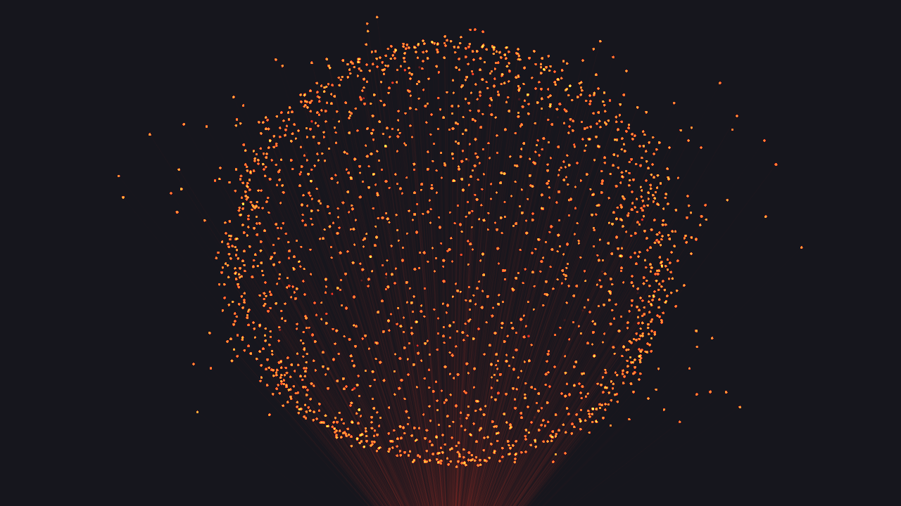

# Sphère laser — TouchDesigner

Un projecteur laser imaginaire, posé sous la forme, vise 3 500 points rouge orangé fluo. Les faisceaux qui les relient à la source sont presque invisibles par défaut ; deux curseurs les font apparaître. Signal faible : la surface pop par plaques. Signal fort : le cœur s'allume et éclate vers l'extérieur, surtout en largeur. Les points scintillent et vibrent comme sur des miroirs de galvanomètre. Fond eigengrau (#16161D).



## Lancer

1. Rejoindre le Wi-Fi **Plante-Musicale** depuis le Mac (le Mac perd internet pendant ce temps).
2. Glisser `plante_sphere.tox` dans un projet, ou reconstruire le réseau depuis le Textport :

```python
exec(open('/Users/jj/Code/claude/00_Claude/OUTPUTS/plante-carte/biodata-pico-main/touchdesigner/build_plante_sphere.py').read())
```

3. Ouvrir les deux fenêtres : dans `plante_sphere`, cliquer **Open** (paramètre *Open in Separate Window*) sur `fenetre_laser` (le rendu seul, 1280 × 720) et sur `fenetre_panneau` (les curseurs, toujours au premier plan). La touche **F1** montre aussi le rendu seul, pour la projection. Les curseurs vivent dans `ui/panneau` ; comme `ui` est un Base COMP, ils n'apparaissent jamais dans le rendu.

La ligne `status_text` donne l'état du flux : source, connexion, période, fréquence, écart en ‰ et intensité. Quand le signal passe, elle affiche `live`.

Sans le Pico : **Source** sur *Simulation*, ou `python tools/dev_server.py` et **Adresse** sur `localhost:8080`. **Intensité manuelle** coupe le signal et laisse le curseur **Intensité** piloter la sphère.

Le Pico accepte deux flux en même temps. Le téléphone en prend un, TouchDesigner le second. Le rendu est en 1920 × 1080, ramené à 1280 × 720 par la licence non commerciale.

## Du signal à l'intensité

`biodata_client.py` lit `/api/stream` dans un thread. À chaque image, `signal_exec` en tire trois mesures :

- l'écart entre la médiane du lot reçu et une ligne de base lente (**Ligne de base**, 3 s) ;
- l'agitation, médiane des écarts entre échantillons successifs ;
- la variation d'un lot à l'autre.

La plus forte des trois est divisée par la période de base. Tout est donc relatif : la plante de test bat à 3,6 ms, le README du Pico prévoit 20 ms, et la sphère réagit pareil. En **Gain auto**, ce rapport est comparé à la plus forte valeur des 8 dernières secondes, sans descendre sous le **Plancher** (1 ‰). **Sensibilité** multiplie le résultat, puis une courbe en puissance 0,7 fait ressortir les petites variations. Sans donnée depuis 1,5 s, l'intensité retombe à 0. Le Lag CHOP lisse : montée 0,04 s, retombée 0,9 s.

Si la connexion reste bloquée plus de 8 s, le client la relance.

## Ce que fait l'intensité

`positions.glsl` tourne trois fois sur le même code : `glsl_points` donne la position et la luminosité de chaque point, `glsl_beams` la direction et la longueur du faisceau depuis la source, `glsl_beamlight` sa luminosité. Deux géométries instanciées lisent ces textures : `geo_dots` (petites sphères) et `geo_beams`. Ce dernier est posé sur la source ; chaque segment en part, orienté par *Rotate to*, sur une longueur égale à la distance au point multipliée par **Portée des faisceaux**.

Le rendu est en 16 bits flottants. Les points sont rendus avec un **Éclat** de 2,6 : leur cœur dépasse 1 et sature, le halo du Bloom garde la couleur. C'est ce qui donne l'effet fluo sans virer au jaune.

- **Peau** (60 % des points) : un champ de plaques bouge en continu. Plus le signal monte, plus de plaques sautent.
- **Cœur** (40 %) : éteint au repos. Au-delà de 0,3, il s'allume du bord vers le centre et part vers l'extérieur.
- **Scintillement** : chaque point clignote à sa propre cadence (18 à 42 Hz), sur un bourdonnement à 50 Hz.
- **Vibration** : un tremblement aléatoire à chaque image, plus fort quand la plante s'agite.
- **Faisceaux** : un sur trois est plus présent, pour que la brume ne soit jamais uniforme. Un Bloom TOP fait le halo.

**La forme suit le signal.** La forme affichée vaut `Forme de départ + Amplitude de forme × intensité`, bornée à 5 : 0 sphère, 1 tétraèdre, 2 cube, 3 octaèdre, 4 dodécaèdre, 5 icosaèdre. Réglages par défaut : départ 0, amplitude 5, donc une plante calme reste sphère et une plante agitée traverse les solides jusqu'à l'icosaèdre. L'intensité utilisée ici passe par un Lag CHOP plus lent (`lag_shape`, réglé par **Lenteur de forme**, 1,5 s à la retombée) : la forme change sur quelques secondes au lieu de trembler. **Forme suit le signal** sur Off fige la forme sur la valeur de départ. Chaque direction est projetée sur la face du solide qu'elle rencontre (inrayon divisé par le plus grand produit scalaire avec les normales des faces). Les solides sont mis à l'échelle pour que la moyenne de leur inrayon et de leur circonrayon vaille 1 : ils gardent à peu près la taille de la sphère. Entre deux entiers, les deux formes sont mélangées.

**Autorotation** fait tourner le solide sur lui-même sur les trois axes, chacun à sa part de la vitesse (X 0,6, Y 1, Z 0,35). Les angles sont intégrés image par image dans le CHOP `spin` : changer la vitesse ne fait pas sauter la forme.

Le déplacement est multiplié par `1 + 1,5 × Largeur` sur X, et tassé sur Y et en profondeur. La rotation s'applique avant : l'élargissement reste horizontal à l'écran.

## Paramètres (`plante_sphere`)

Ceux marqués * sont aussi dans le panneau.

**Signal** : Source, Adresse, Sensibilité*, Plancher (‰), Gain auto, Ligne de base, Montée, Retombée, Intensité manuelle*, Intensité*.

**Sphère** : Nombre de points* (3 500 par défaut), Rayon, Part de surface, Pop de surface, Explosion*, Largeur*, Turbulence, Respiration, Forme de départ*, Forme suit le signal*, Amplitude de forme*, Lenteur de forme, Autorotation* (°/s), Part de rotation X, Y, Z.

**Couleur.** Trois entrées restent synchronisées par `color_exec` : la **Palette** (rouge orangé, rouge, ambre, vert, cyan, bleu, violet, magenta, blanc chaud), le champ **hex** (`#FF1C05`, `ff1c05` ou `f10` acceptés) et la pastille RGB. Toucher l'hex ou la pastille repasse la palette sur « Libre ». Les faisceaux prennent la couleur des points tant que **Faisceaux de la même couleur** est actif. Un GLSL TOP `tonemap` ramène les valeurs au-dessus de 1 sans changer la teinte : avec l'éclat, un ambre reste ambre au lieu de virer au jaune.

**Laser** : Palette*, Couleur (hex)*, Couleur des points* (pastille avec sélecteur), Faisceaux de la même couleur, Couleur des faisceaux, Fond, Faisceaux* (luminosité, 0,03 par défaut), Portée des faisceaux* (0 = rien ne sort de la source, 1 = jusqu'au point), Éclat des points*, Taille des points, Scintillement*, Vibration, Halo*.

**Source** : position du projecteur (X, Y, Z). Par défaut sous la sphère, au bas du cadre. `0, 0, 0` fait partir tous les faisceaux du centre de la sphère.

Pour changer les curseurs du panneau, modifier `VIEW_PARS` dans `build_plante_sphere.py`.

## Fichiers

- `build_plante_sphere.py` construit le composant de zéro (garde Source et Adresse).
- `biodata_client.py` lecture du flux et calcul de l'intensité, sans dépendance à TouchDesigner.
- `positions.glsl` shader des points et des faisceaux.
- `plante_sphere.tox` composant prêt à glisser dans un projet.
- `previews/` quatre états du signal : calme (0), faible (0,15), moyen (0,45), fort (0,9) ; puis les cinq solides au repos (05 à 09). `previews/v1-sans-laser/` garde la première version.
